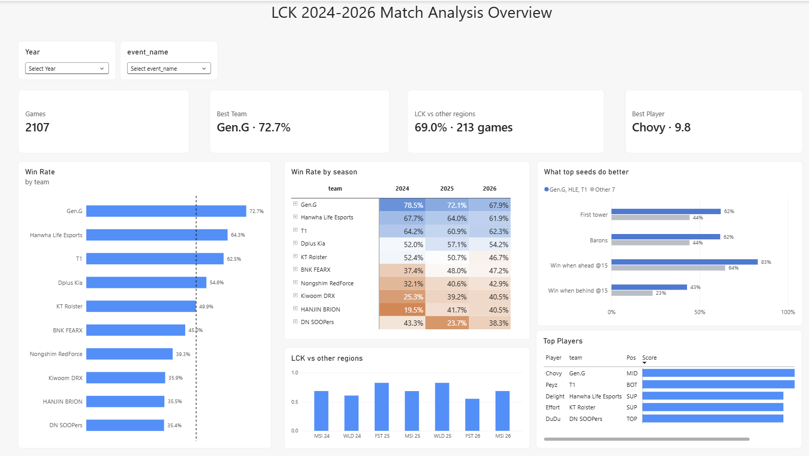

# LCK 2024–2026 Match Analysis

An end-to-end data analysis project on **League of Legends Champions Korea (LCK)** using professional match data from 2024 to 2026: from raw CSV files to a cleaned dataset, SQL and Python analysis in Jupyter, and an interactive **Power BI dashboard**.


---

## Project goals

- Which LCK teams win the most, and how has that changed season by season?
- How does the LCK perform against other regions at Riot international events (MSI, Worlds, First Stand)?
- What do the top teams do differently? Early gold, objectives, or how they close games?
- Who is the most impactful player on each team?

---

## Data

| | |
|---|---|
| **Source** | [Oracle's Elixir](https://oracleselixir.com/) public match data (one CSV per year) |
| **Scope** | Every game played by an LCK team, 2024–2026 |
| **Size** | 2,107 games |
| **Events** | LCK, LCK Cup, MSI, Worlds, First Stand, Esports World Cup, KeSPA Cup, Asian Games and other invitationals |

Each game in the raw data has **12 rows**: 10 player rows and 2 team rows (`position = 'team'`).

**Why 2024–2026?** These seasons share a similar format and meta (feats of strength / void grubs, the LCK Cup, the upper/lower group split from 2025). They also reflect the current rosters. Older seasons can be added later using the same pipeline.

---

## Tools

| Step | Tools |
|---|---|
| Loading and storage | Python, pandas, **Parquet** (pyarrow) |
| Cleaning | pandas |
| Analysis | **DuckDB** (SQL on Parquet), pandas, matplotlib |
| Dashboard | **Power BI** (DAX measures, star schema) |

---

## Project structure

```
LeagueDATA/
├── 20XX_LoL_esports_match_data_from_OraclesElixir.csv   # raw data (one per year)
├── my_parquet/          # raw CSVs converted to Parquet (smaller, faster, keeps types)
├── my_clean/            # cleaned data, one file per season + combined 2024–2026
├── powerbi/             # tables exported for Power BI
│   ├── team_games.parquet      # one row per team per game
│   ├── player_games.parquet    # one row per player per game
│   └── player_scores.parquet   # player ratings (last 100 games)
├── lck_analysis_2024_2026.ipynb   # main notebook
└── project.pbix                   # Power BI dashboard
```

---

## Pipeline

### 1. Load and store
- Read each year's CSV with explicit dtypes (IDs and patch as text, `low_memory=False`).
- Kept **all leagues**, not just the LCK, so international and third-party games involving LCK teams are included.
- Shrunk the data types (category, float32, smaller ints) and saved each year as **Parquet**.

### 2. Clean
- Renamed `dragons_(type_unknown)` and dropped unused columns (`url`, jungle monster splits).
- Mapped leagues to an **event type**: `domestic`, `riot_international` or `third_party`.
- Set @25 minute stats to missing for games shorter than 25 minutes.
- Set `firstbaron = 0` when no baron was taken in the game.
- Checked missing values by column and by row type (team vs player).
- Tagged every row with `is_lck_team`, the `opponent` and `opponent_is_lck`.
- **Season vs calendar year:** the KeSPA Cup in Nov–Dec counts toward the *next* season, which matches how Oracle's Elixir labels it.
- **Team names:** Oracle's Elixir uses each team's **current name** for all seasons (for example, Kwangdong Freecs appears as DN SOOPers).

### 3. Analyse (DuckDB + pandas)
- Win rate overall, by season and by split.
- From 2025, the second half of the season splits into **upper and lower groups**, so those splits are only compared within the same group.
- Domestic vs international win rate, and LCK vs other regions, excluding LCK-vs-LCK games.
- Team playing style: gold @15, first tower, dragons, barons, grubs, vision, kills per minute, win rate when ahead or behind @15.
- Top seeds (Gen.G, HLE, T1) vs the rest.
- Player impact rating (see below).
- Margin of error on win rates (95%), so small samples aren't over-read.

### 4. Export to Power BI
Three tables in a simple star schema, with a `Teams` dimension table linked one-to-many to the fact tables.

---

## Player rating method

Players are compared **only with other players in the same position**.

1. Use each player's **last 100 games (minimum 30) with their current team**.
2. For each stat (KDA, kill participation, damage per minute, damage share, gold and CS diff @15, vision, and others, depending on position), calculate a **z-score** against the other players in that position.
3. Average the z-scores into one **rating**.
4. Convert it to a **score out of 10**: `score = 5 + 2.5 × rating`, clipped to 1–10. A score of 5 means an average LCK player in that role.

---

## Key findings

**Team strength**
- **Gen.G** is the strongest team: **72.7%** win rate over 444 games, 8.4 points ahead of Hanwha Life Esports (64.3%) and T1 (62.5%).
- The bottom four teams (Nongshim, Kiwoom DRX, HANJIN BRION, DN SOOPers) are within four points of each other, at 35–39%.
- **The league is getting tighter.** Gen.G dropped from 78.5% (2024) to 67.9% (2026), while HANJIN BRION climbed from 19.5% to around 41%.

**LCK vs the world**
- LCK teams win **69.0%** of games against other regions at Riot events (213 games).
- Best events: 2025 First Stand and 2025 Worlds (both 82.4%). Weakest: 2026 First Stand (55.0%).
- Toughest opponents: **Bilibili Gaming** (LCK won 51.0% of 49 games), Anyone's Legend (52.9%) and G2 Esports (57.1%).

**What wins games**
- Gold lead @15, baron control and converting leads are almost perfectly linked to win rate across teams (correlation about 0.97–0.98).
- First blood (0.42) and void grubs (0.45) matter much less.
- Top seeds stand out most in **comebacks**: they win **43%** of games when behind at 15 minutes, compared with **23%** for the other teams. They also take first tower (62% vs 44%) and barons (62% vs 44%) far more often.

**Players**
- **Chovy** (Gen.G, mid) has the highest score in the league at **9.8 / 10**, best among mid laners on KDA, damage, gold and CS diff @15 and vision.
- Best player on each of the next teams: Peyz (T1, 8.0), Delight (HLE, 6.9), Effort (KT, 6.9), DuDu (DN SOOPers, 6.9).

---

## Power BI dashboard

**Page 1: LCK 2024–2026 Match Analysis Overview**

| Visual | Shows |
|---|---|
| Season and Event slicers | Filter the whole page by year and by event (LCK, LCK Cup, MSI, Worlds…) |
| KPI cards | Games, Best team, LCK vs other regions, Best player |
| Win rate by team | Bar chart of the 10 LCK teams with a 50% reference line |
| Win rate by season | Matrix with an orange-to-blue colour scale (below and above 50%) |
| LCK vs other regions | Win rate at each Riot international event |
| What top seeds do better | Top 3 vs other 7 on first tower, barons, and winning when ahead or behind @15 |
| Top players | Best player on each team, with score bars out of 10 |

**Main DAX measures**

```DAX
Games    = DISTINCTCOUNT ( team_games[gameid] )      -- counts each game once
Wins     = CALCULATE ( DISTINCTCOUNT ( team_games[gameid] ), team_games[result] = 1 )
Win Rate = DIVIDE ( [Wins], DISTINCTCOUNT ( team_games[gameid] ) )

Intl Games =                                         -- LCK vs other regions only
CALCULATE (
    DISTINCTCOUNT ( team_games[gameid] ),
    team_games[is_lck_team] = TRUE (),
    team_games[event_type] = "riot_international",
    team_games[opponent_is_lck] = FALSE ()
)
```

---

## Notes and limitations

- Win rates are per **game**, not per series.
- `team_games` has one row per team per game, so an LCK-vs-LCK game appears twice. Measures use `DISTINCTCOUNT(gameid)` to avoid double counting.
- International samples are small for some teams (under 20 games), so treat those win rates with caution.
- Player scores reflect recent form with the current team, not a whole career.

---

## Next steps

- **Player Analysis: coming soon 🚧**
  - Player profile page with Team and Player slicers
  - Player photo, score card and key stats
  - Radar chart comparing a player with others in the same position
  - Top 3 champions with icons
  - Win rate by split for each player
- Add 2023 data to extend the trend analysis.

---

## Author

Data analysis portfolio project · Data: Oracle's Elixir · Built with Python, DuckDB and Power BI.
